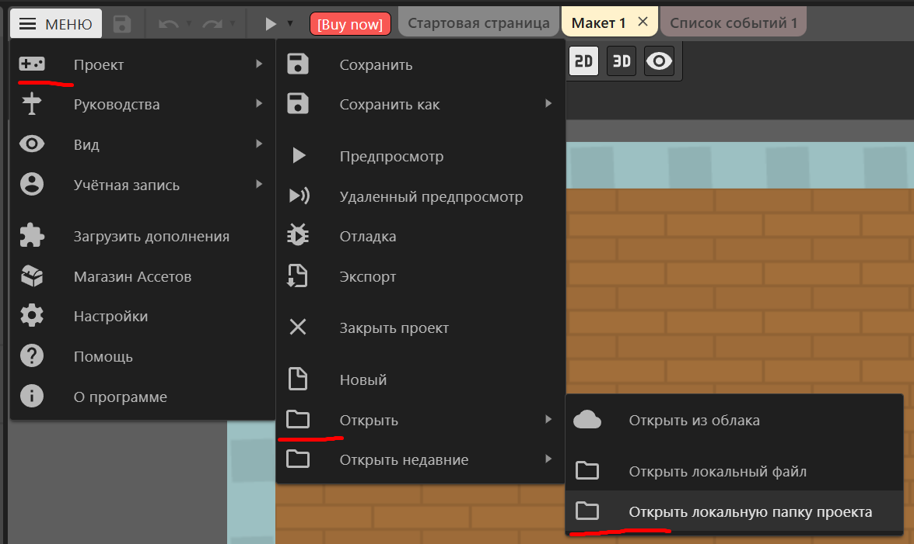
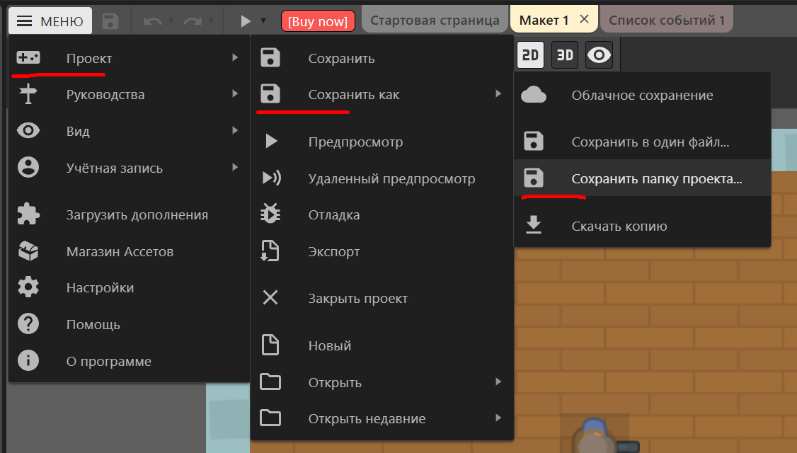

# Apocalypse Store

Проект разрабатывается в рамках дисциплины «Основы проектной деятельности» (ОПД, 1 курс, ИРИТ-РТФ УрФУ).

* **Движок:** Construct 3
* **Платформа:** PC / Web (itch.io)
* **Kanban-доска:** [YouGile](https://ru.yougile.com/board/jug1u2lg7szb)
* **Web-билд:** [itch.io](https://snermory.itch.io/apocalypse-store)

---

## Правила разработки (Workflow)

Вся разработка ведется по модели **GitHub Flow**. Прямые коммиты и пуши в ветку `main` заблокированы.

### Работа ведется следующим образом

**Синхронизация локальной ветки:**
Перед началом работы обязательно заберите актуальный код:
```
git switch main 
git pull origin main
```

**Создание рабочей ветки:** 
Название ветки должно отражать суть задачи из YouGile:
```
git switch -c feature/shooting-mechanics
git switch -c fix/zombie-stuck
```

**Работа в Construct 3:**
Открывайте проект строго через локальную папку проекта, которую подтягиваете с репозитория. Также и для отправки изменений - сохраняйте результат "папка проекта".



**Коммит и отправка изменений:**
Делайте коммиты с понятным описанием на русском или английском
```
git add . 
git commit -m "Добавлена карточка дробовика" 
git push -u origin feature/shooting-mechanics
```

**Создание Pull Request (PR):**
- Перейдите на страницу репозитория на GitHub.
- Нажмите **Compare & pull request** в ветку `main`.
- Укажите краткое описание сделанных изменений (название тикета из YouGile).
- Дождитесь ревью и аппрува. После успешного слияния рабочая ветка удаляется.

**Нейминг веток:**
- `feature/ветка` — новая механика или контент
- `fix/ветка` — исправление бага
- `refactor/ветка` — рефакторинг, чистка кода
Если вы не уверены, какую выбрать, то можете назвать как чувствуете.
